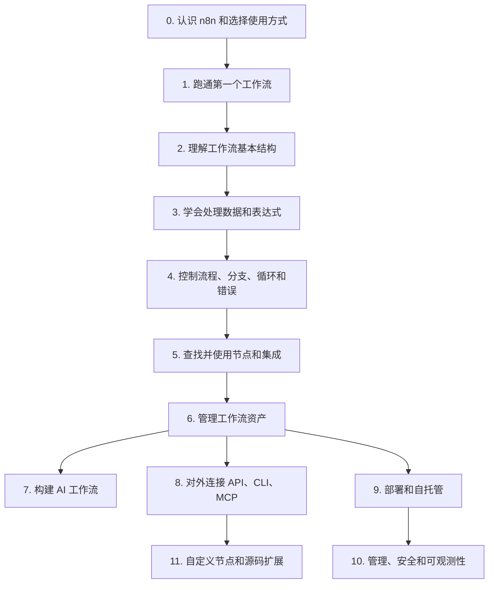

# n8n 全局学习大纲

这个文件是面向人的导航层，不是官方目录的简单复刻。它把 n8n 文档整理成两种入口：

- 学习顺序：从“能跑起来”到“能维护、能扩展”。
- 查找入口：按你现在遇到的问题直接跳到对应文档。

全量资料仍保留在 [官方文档索引](indexes/official-docs-index.md) 和 [源码仓库补充索引](indexes/source-repo-markdown-index.md)。

## 先看这张图

## 推荐学习顺序

| 顺序 | 目标 | 先读什么 | 对应索引 |
| ---: | --- | --- | --- |
| 0 | 判断自己该用 n8n Cloud、Desktop、Docker 还是自托管。 | [Choose your n8n](https://docs.n8n.io/get-started/choose-how-to-use-n8n/)、[n8n Glossary](https://docs.n8n.io/get-started/key-concept-glossary/)、[Learning Paths](https://docs.n8n.io/get-started/learning-paths/) | [入门](indexes/official-docs-by-section/get-started.md) |
| 1 | 先完整跑通一个工作流，不急着理解所有概念。 | [Build your first workflow](https://docs.n8n.io/get-started/build-your-first-workflow/) | [入门](indexes/official-docs-by-section/get-started.md) |
| 2 | 理解 workflow、node、connection、credential、execution 这些核心对象。 | [Workflows](https://docs.n8n.io/build/understand-workflows/)、[Workflow components](https://docs.n8n.io/build/understand-workflows/workflow-components/)、[Create and run workflows](https://docs.n8n.io/build/understand-workflows/create-and-run-workflows/) | [工作流构建](indexes/official-docs-by-section/build.md) |
| 3 | 学会看懂 n8n 的数据结构，知道表达式和数据映射怎么工作。 | [Work with data](https://docs.n8n.io/build/work-with-data/)、[Data structure](https://docs.n8n.io/build/work-with-data/understand-n8ns-data-structure/)、[Transform data](https://docs.n8n.io/build/work-with-data/transform-data/) | [工作流构建](indexes/official-docs-by-section/build.md) |
| 4 | 掌握分支、合并、循环、等待、子工作流和错误处理。 | [Flow logic](https://docs.n8n.io/build/flow-logic/)、[Error handling](https://docs.n8n.io/build/flow-logic/handle-errors-gracefully/)、[Execution order](https://docs.n8n.io/build/flow-logic/understand-execution-order/) | [工作流构建](indexes/official-docs-by-section/build.md) |
| 5 | 开始按服务或能力查节点，不要试图一次读完整个 integrations。 | [Integrations](https://docs.n8n.io/integrations/)、[HTTP Request](https://docs.n8n.io/integrations/builtin/core-nodes/n8n-nodes-base.httprequest/)、[Webhook](https://docs.n8n.io/integrations/builtin/core-nodes/n8n-nodes-base.webhook/)、[Code node](https://docs.n8n.io/integrations/builtin/core-nodes/n8n-nodes-base.code/) | [内置集成与节点](indexes/official-docs-by-section/integrations.md) |
| 6 | 管理工作流资产：导入导出、共享、标签、历史版本、环境间流转。 | [Manage workflows](https://docs.n8n.io/build/manage-workflows/)、[Export and import](https://docs.n8n.io/build/manage-workflows/export-and-import/)、[Source control and environments](https://docs.n8n.io/administer/use-source-control-and-environments/) | [工作流构建](indexes/official-docs-by-section/build.md)、[管理与治理](indexes/official-docs-by-section/administer.md) |
| 7 | 进入 AI 工作流：agent、chain、memory、tool、RAG、向量库和评测。 | [Integrate AI](https://docs.n8n.io/build/integrate-ai/)、[Understand AI components](https://docs.n8n.io/build/integrate-ai/understand-ai-components/)、[Test and improve AI workflows](https://docs.n8n.io/build/integrate-ai/test-and-improve-ai-workflows/) | [工作流构建](indexes/official-docs-by-section/build.md) |
| 8 | 让外部系统调用 n8n，或用 n8n 调外部系统。 | [n8n API](https://docs.n8n.io/connect/n8n-api/)、[API authentication](https://docs.n8n.io/connect/n8n-api/authentication/)、[n8n CLI](https://docs.n8n.io/connect/n8n-cli/)、[MCP server](https://docs.n8n.io/connect/connect-to-n8n-mcp-server/) | [连接、API 与节点开发](indexes/official-docs-by-section/connect.md) |
| 9 | 部署、配置、升级和扩容 n8n。 | [Host n8n](https://docs.n8n.io/deploy/host-n8n/)、[Configuration](https://docs.n8n.io/deploy/host-n8n/configure-n8n/)、[Environment variables](https://docs.n8n.io/deploy/host-n8n/configure-n8n/basic-configuration/use-environment-variables/) | [部署与自托管](indexes/official-docs-by-section/deploy.md) |
| 10 | 管用户、权限、凭据、安全、日志和审计。 | [User management](https://docs.n8n.io/administer/manage-users-and-access/)、[RBAC](https://docs.n8n.io/administer/manage-users-and-access/set-permissions-and-roles-rbac/)、[External secrets](https://docs.n8n.io/administer/manage-credentials/use-external-secret-stores/)、[Observe and log](https://docs.n8n.io/administer/observe-and-log/) | [管理与治理](indexes/official-docs-by-section/administer.md)、[隐私与安全](indexes/official-docs-by-section/privacy-and-security.md) |
| 11 | 开发自定义节点，或者深入源码和包文档。 | [Creating nodes](https://docs.n8n.io/connect/create-nodes/overview/)、[Plan a node](https://docs.n8n.io/connect/create-nodes/plan-your-node/)、[Build your node](https://docs.n8n.io/connect/create-nodes/build-your-node/)、[Test your node](https://docs.n8n.io/connect/create-nodes/test-your-node/) | [连接、API 与节点开发](indexes/official-docs-by-section/connect.md)、[源码仓库补充索引](indexes/source-repo-markdown-index.md) |

## 按角色走

| 角色 | 推荐路径 | 先避开什么 |
| --- | --- | --- |
| 工作流搭建者 | 0 -> 1 -> 2 -> 3 -> 4 -> 5 -> 6 | 先不要读部署、源码、节点开发。 |
| AI 工作流搭建者 | 0 -> 1 -> 2 -> 3 -> 4 -> 7 -> 5 | 先把普通工作流和数据结构学清楚，再看 agent/RAG。 |
| 自托管运维者 | 0 -> 1 -> 9 -> 10 -> 6 | 先不要深入每个节点，重点是配置、升级、安全和可观测性。 |
| 平台集成开发者 | 0 -> 2 -> 3 -> 8 -> 11 | 先把 API、CLI、MCP、自定义节点边界分清楚。 |
| 文档/源码研究者 | 0 -> 2 -> 11 -> [源码仓库补充索引](indexes/source-repo-markdown-index.md) | 不要把源码仓库内部 agent/test/schema 文档当作用户文档入口。 |

## 按问题查找

| 我想找什么 | 直接看哪里 | 关键词 |
| --- | --- | --- |
| 不知道 n8n 怎么开始用 | [入门索引](indexes/official-docs-by-section/get-started.md) | choose、glossary、first workflow |
| 想快速搭一个自动化流程 | [Build your first workflow](https://docs.n8n.io/get-started/build-your-first-workflow/)、[Workflows](https://docs.n8n.io/build/understand-workflows/) | workflow、node、execution |
| 不理解节点之间传的数据 | [Work with data](https://docs.n8n.io/build/work-with-data/)、[Data structure](https://docs.n8n.io/build/work-with-data/understand-n8ns-data-structure/) | item、json、binary、data structure |
| 表达式、字段映射、日期、数组、对象 | [Transform data](https://docs.n8n.io/build/work-with-data/transform-data/)、[Expression reference](https://docs.n8n.io/build/work-with-data/transform-data/expression-reference/) | expression、mapping、array、date、object |
| 条件判断、分支、合并、循环、等待 | [Flow logic](https://docs.n8n.io/build/flow-logic/) | if、switch、merge、loop、wait |
| 调试失败、重跑、看执行记录 | [Executions](https://docs.n8n.io/build/understand-workflows/understand-executions/)、[Debug executions](https://docs.n8n.io/build/understand-workflows/understand-executions/debug-executions/) | execution、debug、retry |
| Webhook 接入外部请求 | [Webhook](https://docs.n8n.io/integrations/builtin/core-nodes/n8n-nodes-base.webhook/)、[Respond to Webhook](https://docs.n8n.io/integrations/builtin/core-nodes/n8n-nodes-base.respondtowebhook/) | webhook、respond |
| 调外部 HTTP API | [HTTP Request](https://docs.n8n.io/integrations/builtin/core-nodes/n8n-nodes-base.httprequest/)、[HTTP Request cookbook](https://docs.n8n.io/build/code-in-n8n/cookbook/http-request-node/) | http、api、pagination、auth |
| 定时任务 | [Schedule Trigger](https://docs.n8n.io/integrations/builtin/core-nodes/n8n-nodes-base.scheduletrigger/) | schedule、cron |
| 写自定义代码 | [Code node](https://docs.n8n.io/integrations/builtin/core-nodes/n8n-nodes-base.code/)、[Code in n8n](https://docs.n8n.io/build/code-in-n8n/) | code、javascript、python、built-in methods |
| 找某个 SaaS 或数据库节点 | [Integrations 分节索引](indexes/official-docs-by-section/integrations.md) | app node、trigger、credential |
| AI agent、tool、memory、RAG | [Integrate AI](https://docs.n8n.io/build/integrate-ai/)、[Understand AI components](https://docs.n8n.io/build/integrate-ai/understand-ai-components/) | agent、chain、memory、tool、rag、vector |
| AI 工作流质量评估 | [Test and improve AI workflows](https://docs.n8n.io/build/integrate-ai/test-and-improve-ai-workflows/) | evaluation、metrics、quality |
| API、CLI、MCP 集成 | [Connect 分节索引](indexes/official-docs-by-section/connect.md) | api、cli、mcp |
| Docker、自托管、环境变量 | [Deploy 分节索引](indexes/official-docs-by-section/deploy.md) | docker、environment variables、database、queue |
| 队列模式、扩容、worker | [Deploy 分节索引](indexes/official-docs-by-section/deploy.md) | queue、worker、redis、scaling |
| 用户、权限、SSO、RBAC | [Administer 分节索引](indexes/official-docs-by-section/administer.md) | user、rbac、saml、oidc、ldap、2fa |
| 凭据、OAuth、外部密钥 | [Manage credentials](https://docs.n8n.io/administer/manage-credentials/)、[External secrets](https://docs.n8n.io/administer/manage-credentials/use-external-secret-stores/) | credential、oauth、external secrets |
| 日志、监控、审计 | [Observe and log](https://docs.n8n.io/administer/observe-and-log/) | logs、insights、audit |
| 版本发布和升级变化 | [Release notes](indexes/official-docs-by-section/release-notes.md) | release、upgrade、breaking changes |
| 开发自定义节点 | [Create nodes](https://docs.n8n.io/connect/create-nodes/overview/) | node creator、declarative、programmatic、linter |
| 查源码仓库 README、CLI、包文档 | [源码仓库补充索引](indexes/source-repo-markdown-index.md) | packages、cli、docker、frontend、testing |

## 官方目录如何理解

| 官方层级 | 应该怎么用 | 本地入口 |
| --- | --- | --- |
| `get-started` | 新手入口，只解决“怎么开始”和“先学什么”。 | [入门](indexes/official-docs-by-section/get-started.md) |
| `build` | 最重要的学习主线，覆盖工作流、数据、流程控制、AI 和工作流管理。 | [工作流构建](indexes/official-docs-by-section/build.md) |
| `integrations` | 最大的资料区，按节点或凭据查，不建议顺序阅读。 | [内置集成与节点](indexes/official-docs-by-section/integrations.md) |
| `connect` | API、CLI、MCP、自定义节点开发。 | [连接、API 与节点开发](indexes/official-docs-by-section/connect.md) |
| `deploy` | 自托管、配置、数据库、队列、Kubernetes、升级和扩容。 | [部署与自托管](indexes/official-docs-by-section/deploy.md) |
| `administer` | 用户、权限、凭据治理、日志、source control 和环境。 | [管理与治理](indexes/official-docs-by-section/administer.md) |
| `privacy-and-security` | 隐私、安全和合规说明。 | [隐私与安全](indexes/official-docs-by-section/privacy-and-security.md) |
| `release-notes` | 版本变化、升级关注点。 | [发布说明](indexes/official-docs-by-section/release-notes.md) |
| `reusable-content` | 文档复用片段，通常不是学习入口。 | [复用内容片段](indexes/official-docs-by-section/reusable-content.md) |
| `document-templates` / `skills` / `styles` | 官方文档协作和写作资料，普通用户一般不用看。 | [文档模板](indexes/official-docs-by-section/document-templates.md)、[文档协作技能](indexes/official-docs-by-section/skills.md)、[写作风格规则](indexes/official-docs-by-section/styles.md) |

## 阅读策略

1. 学习 n8n 时，优先读 `get-started` 和 `build`，只在需要具体节点时查 `integrations`。
2. 做自托管时，优先读 `deploy`，再读 `administer` 和 `privacy-and-security`。
3. 做平台集成时，优先读 `connect`，再根据需要查 `source-repo-markdown-index.md`。
4. 查节点不要翻全表，直接在 [integrations 分节索引](indexes/official-docs-by-section/integrations.md) 里搜索服务名、节点名或 credential。
5. 中文简介只是定位辅助；涉及版本、参数、安全和许可边界时，以链接指向的官方原文为准。
