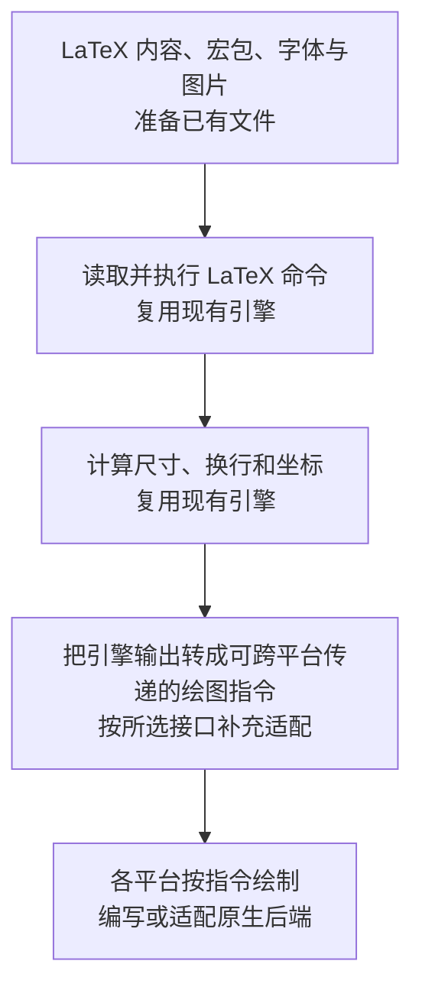

# Rust + 跨平台原生 LaTeX 内容展示

调研日期为 2026-11-18。目标沿用 RaTeX 的分工，由 Rust 解析、排版并交付布局结果与绘图指令，各平台使用原生绘制能力展示。内容覆盖正文、公式、图片、表格与整体布局，现有库优先复用，包括引擎核心。

本轮按五项标准核对候选。LaTeX 内容覆盖决定能接收哪些原文，输出接口决定能否交给原生绘制，补充工作决定集成规模，平台依赖决定部署条件，许可证决定采用与分发时需要遵守的条款。这里记录源码事实、接口小样例和据此形成的判断。各平台构建、中文实际绘制、完整文档兼容与性能仍待验证。

## 从一段源文到原生画面的完整流程

2026-11-19 补充流程说明。先用下面的题目正文串起各部分。这里只展示用于讲解的正文片段，完整文档还需要文档类、相关宏包和字体。

```latex
\textbf{计算} $\frac{1}{2}+\frac{1}{3}=$
```

最后希望屏幕上显示加粗的“计算”和两个竖式分数。可以按以下职责理解这条链路，引擎内部的命令执行与布局计算可能交错进行。



**这里的“读取并执行”和“计算布局”通常可以复用同一个引擎库。** 库的选择会改变接下来如何拿到结果，但这些职责仍然存在。

| 步骤 | 对这道题具体做什么 | 现有部分与需要补充的工作 |
| --- | --- | --- |
| 准备内容和资源 | 提供题目源文，准备 LaTeX 命令定义和实际字体 | 宏包、字体、图片可用现有文件；应用需要整合资源与加载方式 |
| 读取并执行命令 | 执行 `\textbf`、`\frac` 的现有定义，落实到字体、分子、分母和分数线等底层操作 | 选用兼容引擎后，复用其执行能力以及已有 LaTeX 宏代码 |
| 计算布局 | 计算分数的尺寸、基线以及它与文字的间距，再按容器宽度决定断行，确定绘制位置 | 优先复用引擎的排版能力；宿主传入宽度、字号和资源等条件，并核对结果 |
| 整理绘图结果 | 从引擎结果中取得“哪个字形放在哪里、哪条线画在哪里”，整理成各平台可消费的数据 | 复用引擎输出接口或解析库；补统一坐标、字体与图片资源引用、数据传递及未覆盖指令的处理 |
| 平台原生绘制 | Android、iOS 等分别把字形、分数线或图片画到对应画布上 | 复用平台已有绘图 API，编写或适配读取这份指令的代码；RaTeX 的原生后端可作参考 |

“布局结果”描述内容的尺寸与位置。“绘图指令”描述怎样把这些内容画出来。上面的例子中，两者可以对应为分子、分母的位置与尺寸，以及在这些位置绘制字形和分数线的操作。这里尚未规定具体的数据格式。

### 用已调研的库对应这些位置

以 retex 作为讲解例子，它可以承担命令执行与文档排版，页面后端接口能够交付带位置的字形、矩形和图片。应用侧要接住这些输出，整理字体与图形资源，再交给各平台绘制。这条直接后端路径已完成源码核对，完整题面和端侧效果仍待验证。它的回调也包含原始 PDF 绘图代码，覆盖这部分内容需要额外解释或复用已有解释器。[retex 页面后端](https://gitlab.com/severin-lemaignan/retex/-/blob/86b0f2f100627714ada713923c789b1746c30c7f/crates/retex-engine/src/shipout.rs)

如果引擎先生成 PDF，流程中“整理绘图结果”的实现方式会变化。可以复用 hayro，把 PDF 解释为字形、路径、图片等绘制回调，再整理成平台要消费的数据。这样能复用更多图形解释代码，也增加了中间处理。[hayro 绘制接口](https://github.com/LaurenzV/hayro/blob/61f50b42a7f7b15764780b9ba534cba91488bb28/hayro-interpret/src/device.rs)

因此，首轮库调研已经找到命令执行、文档排版和部分输出提取的现成实现。目前尚未接通的是“选定库的输出 → 跨平台可传递的绘图结果 → 各平台原生画面”。这一段需要结合真实题目验证哪些能复用、哪些要补充，现阶段还不能给出已经完成全部复用的结论。

元素位置框可以从这条流程进一步导出。对作答区等目标，应用还需要保留 ID 与布局中对应范围的关联；字体、行框或页面坐标本身无法说明哪一块属于哪道小题。

许可证也对应到实际使用的部分。加载的宏包与字体、选用的引擎、图形解释库以及平台适配依赖，都要按最终采用的文件和组件分别核对，下文保留了现有核对结果。这里以 retex 讲解职责，具体选型还需要结合覆盖、端侧效果和许可证判断。

## 现有库可以复用到哪一步

**文档级引擎、结构化布局和绘制回调都有现成代码可以复用，组合到目标链路仍需要适配。** 对完整 LaTeX 内容，优先研究 retex 的页面后端，以及现有引擎输出到 XDV／PDF 后提取绘制操作的路径。MiTeX + Typst 提供另一条结构清晰的路径，其输入覆盖需要按题例确认。

| 候选 | 内容与实现范围 | 可获取的布局或绘制结果 | 主要补充工作 |
| --- | --- | --- | --- |
| retex | 以 LuaTeX 兼容为目标的 Rust 引擎，读取 LaTeX 宏包与字体；完整运行还涉及 Lua 解释器等依赖 | `shipout::Backend` 有页面、定位字形、矩形、图片、变换及原始 PDF literal 回调 | 将回调记录为跨平台显示列表，处理 literal、资源、字体和元素标记，验证移动端构建 |
| Tectonic + `tectonic_xdv` | Rust 接口封装 XeTeX 链路，包含 C/C++；可处理文档级 LaTeX | `OutputFormat::Xdv`；解析器暴露定位字形、字体、矩形与 special 事件 | 补传统字体信息与字符位置，解释图片、颜色、路径等 special，统一资源和坐标 |
| retex／Tectonic + `hayro-interpret` | 前端引擎完成 LaTeX 排版，hayro 解释生成的 PDF | `Device` 暴露字形、路径、图片、裁剪、透明组等绘制回调 | 记录显示列表或实现平台 Device，覆盖混合模式／遮罩，另行保留题目元素的语义 ID |
| MiTeX + Typst | Rust 转换器把已支持的 LaTeX 写法转换成 Typst，再由 Typst 排版 | Typst `Frame` 含带位置的文字、形状、图片、子 Frame、变换与裁剪 | 验证 LaTeX 转换覆盖，加载 MiTeX 的 Typst 定义，遍历 Frame 并实现原生后端 |
| `tex_engine`／RusTeX | Rust TeX 执行与节点模型，RusTeX 当前输出以 HTML 为主 | 有 shipout 续接点，可接收盒子／节点树 | 从节点计算最终位置，补齐排版精度及后端，核对 GPL 分发条件 |
| `realtime-tex` | Rust 会话层与 Lua 捕获代码，调用现有 LuaLaTeX | 已有 `rtex-dl` 显示列表、字体描述、行框及部分源文归属，支持 JSON／二进制 | 准备 LuaTeX 与资源，移植进程通信，补超出显示列表覆盖的内容及平台绘制 |
| RaTeX | 公式及数学相关扩展，已采用 Rust + 原生绘制 | 公式 DisplayList | 适合作为基线及平台绘制参考，文档级段落、图表和分页需要其他能力 |
| yingkitw/rtex | Rust LaTeX 子集转换器，使用 pdfrs 生成 PDF | AST、PDF／HTML 等输出；本轮所读公开入口主要面向转换结果 | 定位并导出最终布局，验证转换覆盖；本轮作为次要候选 |

### retex 的直接后端值得优先验证

源码公开了 `Engine.backend` 与 `shipout::Backend`。页面输出时，回调可接收字形原点、矩形、图片和页面尺寸。坐标采用 sp，原点在页面左下，y 轴向上。可以据此实现一个记录绘图操作的后端，这是基于源码接口的可行性判断，本轮只完成静态核对。 [后端接口](https://gitlab.com/severin-lemaignan/retex/-/blob/86b0f2f100627714ada713923c789b1746c30c7f/crates/retex-engine/src/shipout.rs) · [引擎入口](https://gitlab.com/severin-lemaignan/retex/-/blob/86b0f2f100627714ada713923c789b1746c30c7f/crates/retex-engine/src/lib.rs)

这里还有一项决定性缺口。后端会收到原始 PDF literal，图片和复用的图形对象也通过资源索引交付。文字、分数线的简单列表还不足以覆盖全部图形内容，需要继续解释路径、图形状态与资源，或在出现这些内容时走其他已验证的绘制路径。字形回调提供引擎字体编号与字符码，适配时还需通过字体表解析实际字形，覆盖传统字体与虚拟字体的情况。

高层 `retex::Retex` 已提供编译到 PDF／SVG 等格式的接口，源码中的 SVG 导出经过 PDF 内容解释。采用自定义页面 Backend 时，需要检查字体、Lua 初始化与构建会话的接入点，不能把高层接口的全部行为直接视为自定义后端已有的能力。 [嵌入流程](https://gitlab.com/severin-lemaignan/retex/-/blob/86b0f2f100627714ada713923c789b1746c30c7f/docs/manual/chapters/embedding.tex) · [SVG 输出链路](https://gitlab.com/severin-lemaignan/retex/-/blob/86b0f2f100627714ada713923c789b1746c30c7f/crates/retex-svg/src/lib.rs)

### Tectonic 的 XDV 提供了坐标入口，但解析覆盖要补齐

源码支持选择 XDV 输出。`tectonic_xdv::XdvEvents` 提供字体、字形 ID、坐标数组、矩形与 special 回调。本轮用库中的现成 XDV 样例实际调用解析器，确认可以读出定位字形。 [输出选择](https://github.com/tectonic-typesetting/tectonic/blob/d2224d9ba4185f952fd3d982eccd1f444dbdf895/src/driver.rs) · [解析接口](https://github.com/tectonic-typesetting/tectonic/blob/d2224d9ba4185f952fd3d982eccd1f444dbdf895/crates/xdv/src/lib.rs)

同一份解析源码会读取后丢弃传统字体定义，传统字符回调也没有直接携带逐字坐标。图片样例则返回 `pdf:image ...` special，尚需调用方解释为图片操作。因而需要补齐传统字体度量、字符推进和 special 语义，才能覆盖普通数学字体和图文混排。该缺口已由源码与小样例交叉核对。[实验记录](evaluation.md)

### PDF 也可以作为通往原生绘图的中间结果

`hayro-interpret::Device` 提供 `draw_glyph_run`、`draw_path`、`draw_image`、裁剪与透明组回调。可以研究将引擎生成的 PDF 解释成自有绘图指令，再由平台绘制。这样可复用 PDF 解释代码来处理已有引擎的图形输出，代价是多一次解释与资源转换。接口包含借用的字体、图片和图形状态，跨 FFI 交付前需要整理所有权及序列化。 [Device 接口](https://github.com/LaurenzV/hayro/blob/61f50b42a7f7b15764780b9ba534cba91488bb28/hayro-interpret/src/device.rs) · [库的适用范围](https://docs.rs/hayro-interpret/0.9.0/hayro_interpret/)

这条路径的 LaTeX 兼容范围由前端引擎决定。PDF 绘图操作本身只保留已排好的页面内容，容器宽度变化仍需重新编译。题干、作答区等业务 ID，需要在前端标记并关联到输出，或借助可验证的 marked-content 信息。

### MiTeX + Typst 的 Frame 结构清楚，输入范围是主要取舍

MiTeX 提供 `convert_text` 和 `convert_math`，输出 Typst 源码。Typst 的 `Frame.items()` 返回带位置的 FrameItem，包含文字、几何形状、图片、子 Frame、链接与标签，子 Frame 支持变换和裁剪。可复用这一布局模型来实现原生后端，仍需要传递实际字体、字形、图片及绘制状态。 [转换接口](https://github.com/mitex-rs/mitex/blob/23ab8dffda5c94f0b69350a060020102a097dc36/crates/mitex/src/lib.rs) · [Frame 类型](https://github.com/typst/typst/blob/7ded3d5259636426eae38c727735eae03f1a2c4c/crates/typst-library/src/layout/frame.rs)

本轮探针确认粗体正文、行内分式和简单 `\newcommand` 可以转换；`\usepackage{exam}` 返回未知命令错误。项目 README 也把更完整的宏包和文本环境支持列为后续工作。后续采用时，需要用真实原题确认可接受的写法，不能据转换成功推定现有 LaTeX 宏包可全部运行。 [输入覆盖说明](https://github.com/mitex-rs/mitex/blob/23ab8dffda5c94f0b69350a060020102a097dc36/README.md) · [转换结果](evaluation.md)

### 另外几项适合复用的能力

`tex_engine` 可通过 shipout 续接点获得节点树，适合探索自己控制输出后端。其文档明确列出部分原语缺失、盒子尺寸与断行分页近似等限制。RusTeX 的 HTML 输出也会依赖浏览器继续呈现，因此原生绘图转换需要专门验证。 [节点交付入口](https://github.com/FlexiFormal/RusTeX/blob/359979dd4eb18343732f17a9e290335b9feea24b/tex_engine/src/engine.rs) · [现有输出](https://github.com/FlexiFormal/RusTeX/blob/359979dd4eb18343732f17a9e290335b9feea24b/rustex/src/shipout/mod.rs) · [库的限制](https://docs.rs/tex_engine/0.1.20/tex_engine/)

`realtime-tex` 已有文档级显示列表。字形记录带字体文件、字形 ID、绝对坐标和字体变换，另有矩形、图片、颜色与行框。它直接调用 LuaLaTeX，平台说明覆盖桌面系统。遇到 TikZ 路径、原始 literal 等内容时会标记降级并提供 PDF 回退。本轮只验证了显示列表编解码，LuaLaTeX 捕获、移动端运行和原生绘制仍待验证。 [显示列表与降级规则](https://github.com/HenryXiaoYang/realtime-tex/blob/9c9be1bd8871991d5e95348f95f16638c0a71a16/docs/display-list.md) · [嵌入接口](https://github.com/HenryXiaoYang/realtime-tex/blob/9c9be1bd8871991d5e95348f95f16638c0a71a16/docs/embedding.md) · [LuaLaTeX 调用](https://github.com/HenryXiaoYang/realtime-tex/blob/9c9be1bd8871991d5e95348f95f16638c0a71a16/crates/rtex-core/src/texlive.rs)

RaTeX 的平台适配与字体绘制值得保留为对照。yingkitw/rtex 的公开入口主要提供 AST 和格式转换，本轮未确认现成的最终坐标／显示列表 API，将其保留为次要候选。 [RaTeX 指令](https://github.com/erweixin/RaTeX/blob/c98ae9d128a3c0a26176b3f3541f3411c4e7c3d6/crates/ratex-types/src/display_item.rs) · [rtex 公开入口](https://github.com/yingkitw/rtex/blob/458aee02d3fae9220f2dc01fdc3ca86eab199300/src/lib.rs) · [PDF 链路](https://github.com/yingkitw/rtex/blob/458aee02d3fae9220f2dc01fdc3ca86eab199300/src/output/pdfrs_pdf.rs)

## 许可证核对

以下记录固定源码中的声明和已发现的组件差异，覆盖候选主体及关键附带资源。整套应用采用时，还需按最终 Cargo 特性、链接组件和随包资源核对许可证清单。本轮的接口探针依赖锁定在实验 Cargo.lock，尚未对所有候选做完整传递依赖审计。

| 项目／组件 | 核对结果 | 采用时需要关注 |
| --- | --- | --- |
| retex 及自有 engine 模块 | CC0-1.0，已读根 LICENSE 与 Cargo 声明 | 外部依赖和 TeX Live 资源分别核对；完整运行使用 mlua 的 vendored Lua 5.3 等组件 |
| Tectonic | 根 LICENSE 与 Cargo 标注 MIT；`engine_xdvipdfmx/xdvipdfmx/dvipdfmx.c` 文件头为 GPL-2.0-or-later | 项目级 MIT 与组件声明需要一起核对，默认依赖包含 PDF 后端；选择 XDV 输出也要检查实际构建／链接图 |
| `tectonic_xdv` | Cargo 标注 MIT，代码文件有 MIT 声明 | 单独解析库与完整 Tectonic 引擎分别记录 |
| `tex_engine`／RusTeX | 两个 Cargo 清单均标注 GPL-3.0-or-later | 分发与链接方案需按 GPL 条款评估，本轮源码根目录未见独立 LICENSE 文件 |
| `realtime-tex`／`rtex-dl` | MIT，已读根 LICENSE | 外部 LuaTeX、TeX Live 和字体按各自许可核对 |
| MiTeX／Typst | Apache-2.0，MiTeX 已读 LICENSE，Typst 已读 LICENSE | 按条款保留许可与适用的 NOTICE，字体和转换包依赖另列 |
| `hayro-interpret` | Cargo 为 Apache-2.0 OR MIT，根目录两份许可均存在 | NOTICE 另列来自 PDFBox、pdf.js、png 的 Apache-2.0 部分，需随实际采用代码保留相应声明 |
| RaTeX | 引擎 MIT；随带 KaTeX 字体为 SIL OFL-1.1 | 字体许可与代码许可分别保留，修改字体时核对保留字体名要求 |
| yingkitw/rtex | Cargo 和 README 声明 Apache-2.0 | 本轮固定源码根目录未见独立 LICENSE 文件，依赖 pdfrs 等另行核对 |

retex 的依赖文档明确列出 Lua 解释器、字体塑形和图像等依赖。CC0 的适用范围仍以著作权人有权授权的内容为限。[CC0 原文](https://gitlab.com/severin-lemaignan/retex/-/blob/86b0f2f100627714ada713923c789b1746c30c7f/LICENSE) · [依赖说明](https://gitlab.com/severin-lemaignan/retex/-/blob/86b0f2f100627714ada713923c789b1746c30c7f/DEPENDENCIES.md) · [CC0 条款](https://creativecommons.org/publicdomain/zero/1.0/legalcode.en)

Tectonic 的组件差异可回溯到实际源文件，Rust 包清单中的许可字段无法替代该核对。[根 LICENSE](https://github.com/tectonic-typesetting/tectonic/blob/d2224d9ba4185f952fd3d982eccd1f444dbdf895/LICENSE) · [后端包清单](https://github.com/tectonic-typesetting/tectonic/blob/d2224d9ba4185f952fd3d982eccd1f444dbdf895/crates/engine_xdvipdfmx/Cargo.toml) · [GPL 文件头](https://github.com/tectonic-typesetting/tectonic/blob/d2224d9ba4185f952fd3d982eccd1f444dbdf895/crates/engine_xdvipdfmx/xdvipdfmx/dvipdfmx.c) · [默认依赖](https://github.com/tectonic-typesetting/tectonic/blob/d2224d9ba4185f952fd3d982eccd1f444dbdf895/Cargo.toml)

其余主体声明与附带声明分别保留来源。[tex_engine](https://github.com/FlexiFormal/RusTeX/blob/359979dd4eb18343732f17a9e290335b9feea24b/tex_engine/Cargo.toml) · [RusTeX](https://github.com/FlexiFormal/RusTeX/blob/359979dd4eb18343732f17a9e290335b9feea24b/rustex/Cargo.toml) · [realtime-tex](https://github.com/HenryXiaoYang/realtime-tex/blob/9c9be1bd8871991d5e95348f95f16638c0a71a16/LICENSE) · [MiTeX](https://github.com/mitex-rs/mitex/blob/23ab8dffda5c94f0b69350a060020102a097dc36/LICENSE) · [Typst](https://github.com/typst/typst/blob/7ded3d5259636426eae38c727735eae03f1a2c4c/LICENSE) · [hayro 清单](https://github.com/LaurenzV/hayro/blob/61f50b42a7f7b15764780b9ba534cba91488bb28/Cargo.toml) · [hayro NOTICE](https://github.com/LaurenzV/hayro/blob/61f50b42a7f7b15764780b9ba534cba91488bb28/NOTICE.md) · [RaTeX 字体声明](https://github.com/erweixin/RaTeX/blob/c98ae9d128a3c0a26176b3f3541f3411c4e7c3d6/licenses/KaTeX-fonts-NOTICE.txt) · [rtex 声明](https://github.com/yingkitw/rtex/blob/458aee02d3fae9220f2dc01fdc3ca86eab199300/Cargo.toml)

LaTeX 内核与基础宏包主要使用 LPPL。直接运行、修改后分发、随应用分发宏包与字体，是需要分别按对应条款核对的使用方式。后续应按选定的实际资源集合生成分发清单。[LPPL 1.3c 原文](https://www.latex-project.org/lppl/lppl-1-3c/)

## 本轮实际验证与尚需补充的能力

探针运行于 macOS arm64、Rust 1.95.0。使用固定源码中的库接口与测试文件，完成以下验证。[程序、输入、复跑命令与原始输出](evaluation.md)

| 实验 | 实际结果 | 证据边界 |
| --- | --- | --- |
| Tectonic 原生字体 XDV | 1 页，2 个原生字体定义，9 个定位字形，另有 1 个传统字符 | 证明样例能输出字形及坐标；传统字体与字符处理仍有缺口 |
| Tectonic 图片 XDV | 1 页，21 个传统字符；图片以 `pdf:image ...` special 返回 | 证明图片指令可保留，转换成原生图片操作仍需实现 |
| `rtex-dl` 人工矩形与降级记录 | JSON → 二进制 → 对象后记录一致，降级标记保留 | 验证协议编解码；这些人工输入不代表真实文档捕获或视觉精度 |
| MiTeX 正文、公式与简单宏 | 转为 Typst 代码 | 验证输入子集的转换；Typst 排版及平台绘制待验证 |
| MiTeX 加载 exam 宏包 | `unknown command: \usepackage` | 该样例超出本轮转换器覆盖 |

跨平台原生展示还需要完成以下连接工作。字体资源必须能按相同字形 ID 或轮廓被各端使用，坐标、基线、页面原点与单位需要统一转换，图片、路径、裁剪和透明组需要在后端中保持语义。若选择包含原始 PDF literal 或 special 的接口，还需明确其解释范围与未支持时的处理方式。

布局结果也要补齐宿主需要的元数据。字符与行框、题干或作答区 ID、跨行跨页范围需要有明确关联。纸面坐标或绘图指令并不自动携带题型语义。容器宽度改变后，需要重新运行相应布局，并核对换行、图片大小、表格宽度和位置框。

## 后续样例怎样比较

建议把 retex 自定义 Backend 与文档引擎 + hayro Device 作为优先验证的两条路径，Tectonic XDV 用于对照字体和 special 的补充成本。前两条路径分别能复用页面输出接口和 PDF 图形解释器。若直接后端难以覆盖 literal，可比较复用 hayro 的额外成本；若 PDF 中间层不能满足位置标记或响应速度，再评估直接输出的收益。

MiTeX + Typst 适合同时检验“输入可约束时能减少多少布局工作”，决定是否采用前需确认真实题目所需命令和环境能被转换。`realtime-tex` 的显示列表和源文归属可作为接口参考。GPL 的 `tex_engine` 路线应把分发约束与技术缺口一起纳入选择。

对照样例应共用中文段落、行内与陈列公式、加粗／斜体、图片、表格、作答区和一个自定义宏。在两种容器宽度下，核对所有内容是否进入绘制结果，以及原生展示、位图和位置框是否一致。随后测量首个结果耗时、重排耗时、内存和资源包体。上述样例与平台验证构成下一阶段，当前结论支持库与接口的候选判断。

## 固定源码版本

以下均以源码 SHA 为核对身份，避免滚动文档中 latest 指向不同版本。retex 清单版本为 2.0.0-beta.2，realtime-tex 为 0.0.7，MiTeX 为 0.2.7，tex_engine 为 0.1.20，RusTeX 库为 0.1.18，hayro-interpret 为 0.9.0，yingkitw/rtex 为 0.1.11。Tectonic 与 Typst 按下列源码快照核对。

- retex `86b0f2f100627714ada713923c789b1746c30c7f`
- tectonic `d2224d9ba4185f952fd3d982eccd1f444dbdf895`
- realtime `9c9be1bd8871991d5e95348f95f16638c0a71a16`
- rustex `359979dd4eb18343732f17a9e290335b9feea24b`
- mitex `23ab8dffda5c94f0b69350a060020102a097dc36`
- typst `7ded3d5259636426eae38c727735eae03f1a2c4c`
- rtex `458aee02d3fae9220f2dc01fdc3ca86eab199300`
- ratex `c98ae9d128a3c0a26176b3f3541f3411c4e7c3d6`
- hayro `61f50b42a7f7b15764780b9ba534cba91488bb28`
