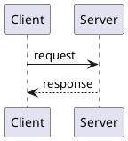
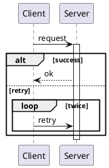
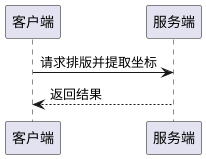
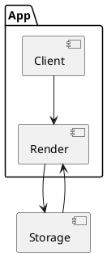

# PlantUML Rust 可行性样例验证

日期为 2026-11-18。实验在 macOS aarch64 上使用 Rust 1.95.0 与 Cargo 1.95.0，直接链接 Omaspec 的 omaspec-uml 0.9.9。源码 SHA 为 11871f8474287b99ccd814404305e50574425f54，依赖解析为 miniz_oxide 0.9.1 和 adler2 2.0.1。

TechLab 的[调研结论](README.md)引用本记录。这里保留实验输入、调用方式和原始结果，后续可以独立复跑。

## 调用程序与复跑方法

下载并解开固定源码归档，在解压目录旁创建 probe，按下文内容保存 Cargo.toml、src/main.rs 和各份 puml 输入。

```sh
curl -L --fail https://codeload.github.com/enhapu-afk/omaspec/tar.gz/11871f8474287b99ccd814404305e50574425f54 -o omaspec.tar.gz
tar -xzf omaspec.tar.gz
cargo run --manifest-path probe/Cargo.toml -- probe/basic.puml
```

Cargo.toml 内容如下。

```toml
[package]
name = "plantuml-feasibility-probe"
version = "0.0.0"
edition = "2024"

[dependencies]
omaspec-uml = { path = "../omaspec-11871f8474287b99ccd814404305e50574425f54/crates/omaspec-uml" }
```

src/main.rs 内容如下。

```rust
fn main() {
    let path = std::env::args().nth(1).expect("path to puml");
    let source = std::fs::read_to_string(&path).expect("read input");
    match omaspec_uml::render_mapped(&source, None) {
        Ok((svg, map)) => {
            let end = svg.find('>').expect("svg header");
            println!("OK {} messages={} states={} wires={} {}", path, map.messages.len(), map.states.len(), map.wires.len(), &svg[..=end]);
            std::fs::write(format!("{path}.svg"), svg).expect("save svg");
        }
        Err(e) => println!("DECLINED {} line={:?} refused={} reason={}", path, e.line, e.refused, e.reason),
    }
}
```

后续四个输入可以直接传给 probe/target/debug/plantuml-feasibility-probe，参数为对应的 puml 文件路径。程序直接调用 Rust 核心，没有经过桌面应用的 Java 回退入口。

## 输入

### basic.puml



### groups.puml



### chinese.puml



### component.puml



### unsupported.puml

```plantuml
@startdot
digraph { a -> b }
@enddot
```

## 原始输出

工作目录的临时路径以 probe/ 代替，其余输出保留。

```text
OK probe/basic.puml messages=2 states=0 wires=0 <svg xmlns="http://www.w3.org/2000/svg" width="169" height="152" viewBox="0 0 169 152">
OK probe/groups.puml messages=3 states=0 wires=0 <svg xmlns="http://www.w3.org/2000/svg" width="158" height="270" viewBox="0 0 158 270">
OK probe/chinese.puml messages=2 states=0 wires=0 <svg xmlns="http://www.w3.org/2000/svg" width="229" height="152" viewBox="0 0 229 152">
OK probe/component.puml messages=0 states=0 wires=3 <svg xmlns="http://www.w3.org/2000/svg" width="144" height="214" viewBox="0 0 144 214">
DECLINED probe/unsupported.puml line=Some(0) refused=false reason=`@startdot` diagrams are drawn by the Java PlantUML only
```

四个成功输出通过 Python 标准库 xml.etree.ElementTree 解析。同一机器重复运行，四份 SVG 的字节分别与前一次相同。中文输出的文本节点中保留了「客户端」「服务端」「请求排版并提取坐标」「返回结果」。

这些结果支持样例链路可运行。视觉效果、中文实际字形、原版 PlantUML 对照、Android 原生绘制与性能仍待验证。
